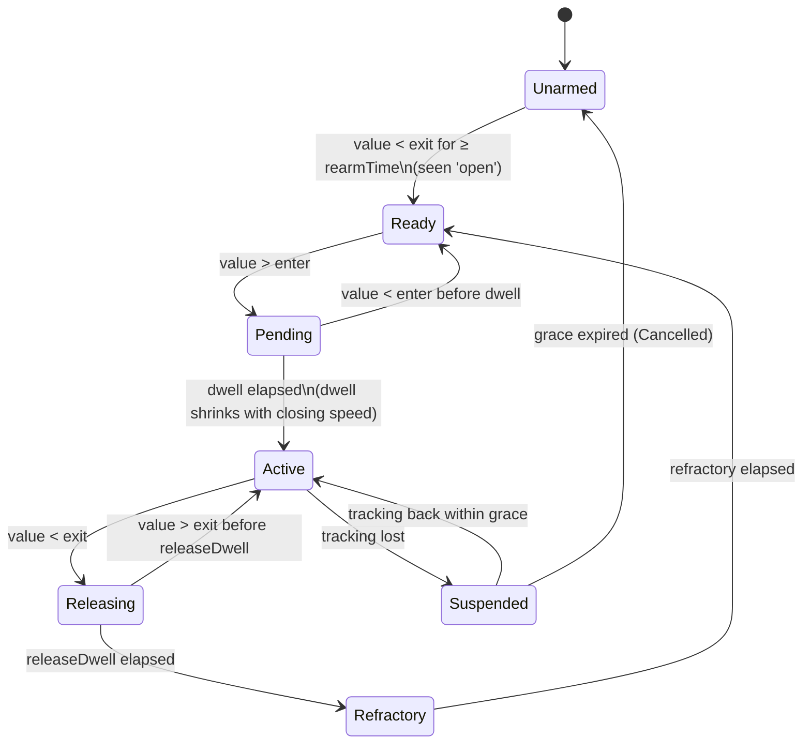

# GestureComposer: Draft Proposal

**Status:** Draft v0.1 · **Date:** 2026-10-24
**Scope:** A C++17, dependency-free, CMake `add_subdirectory` library that detects hand gestures from a world-space hand skeleton, works across OpenXR and Apple Vision Pro, and lets the application compose gestures (poses, timed sequences, chords) through one small, declarative API.

---

## 1. Goals and non-goals

### Goals
1. **Accurate and robust.** Few false activations, few missed activations, no double-firing. Specifically fixes the two failures already seen:
   - debounce failures and more than one gesture firing for one physical action;
   - the "palm toward head + index pinch" menu firing while the user grips something like a steering wheel.
2. **Feels good.** Low latency on intentional actions, stable aim rays, continuous progress values so the app can show feedforward ("the pinch ring is closing").
3. **Simple to author.** A developer describes *what* the gesture is (pose, timing, context) and does not hand-write state machines. Gesture definitions are application code; the library ships primitives, not a fixed gesture set.
4. **Cross-platform input.** One canonical skeleton. Thin adapters for OpenXR `XR_EXT_hand_tracking` and visionOS ARKit `HandSkeleton`. Missing joints are synthesized.
5. **Cheap on headset CPUs.** Zero heap allocation per frame, work that depends only on the gestures actually registered, and a budget in microseconds (§9).
6. **Testable.** Deterministic: the same input stream always produces the same events. Record/replay is built in so thresholds are tuned against data, not by feel alone.

### Non-goals (v1)
- Hand tracking itself (we consume skeletons).
- Rendering, UI, haptics or audio (we emit events and continuous values; the app gives feedback).
- A trained deep-learning classifier in the core. An optional lightweight learned-template path is described in §7.4.

---

## 2. Design at a glance

```mermaid
flowchart LR
  A[Platform skeleton<br/>OpenXR / visionOS] -->|adapter| B[HandSample<br/>canonical joints]
  B --> C[Conditioning<br/>validity, dropout grace,<br/>1€ filtering, hand scale]
  C --> D[Feature cache<br/>curl, spread, pinch capsules,<br/>palm frame, velocities, rays]
  D --> E[Signals<br/>soft 0..1 + confidence]
  E --> F[Conditions<br/>Schmitt trigger + dwell<br/>+ onset requirement]
  F --> G[Temporal matchers<br/>press / click / hold /<br/>seq / repeat / chord]
  G --> H[Arbitration<br/>tokens, priority,<br/>exclusive groups]
  H --> I[Events + state<br/>Armed/Began/Updated/<br/>Ended/Cancelled/Triggered]
```



Four ideas carry most of the robustness:

| Idea | What it fixes |
|---|---|
| **Soft signals, hard decisions late.** Every primitive is a continuous score in [0,1] with a confidence. Thresholding happens once, in a hysteresis + dwell stage. | Threshold chatter, and brittle AND-chains of booleans. |
| **Onset requirement ("performed, not found").** A press must be seen *transitioning* from open to closed within a time window. A pinch that is already closed never fires. | Steering-wheel misfires, hands entering tracking already pinched, re-fires after tracking dropouts. |
| **Input tokens and arbitration.** Each physical edge (e.g. "right index pinch onset #42") is a token that only one gesture may consume, unless a gesture opts into sharing. | More than one gesture firing for one action; select and menu both firing. |
| **Arm-before-trigger ordering.** Context poses (such as palm toward head) must be stable *before* the trigger onset. | Context and trigger becoming true together by accident. |

---

## 3. Input model

### 3.1 Canonical types (POD, no dependencies)

```cpp
namespace gc {

struct Vec3 { float x, y, z; };
struct Quat { float x, y, z, w; };
struct Pose { Vec3 position; Quat orientation; };
struct Ray  { Vec3 origin; Vec3 direction; };

enum class Hand   : uint8_t { Left, Right };
enum class Finger : uint8_t { Thumb, Index, Middle, Ring, Little };

// Canonical order = OpenXR XR_EXT_hand_tracking (26 joints) + 2 optional forearm joints.
enum class Joint : uint8_t {
  Palm, Wrist,
  ThumbMetacarpal, ThumbProximal, ThumbDistal, ThumbTip,
  IndexMetacarpal, IndexProximal, IndexIntermediate, IndexDistal, IndexTip,
  MiddleMetacarpal, MiddleProximal, MiddleIntermediate, MiddleDistal, MiddleTip,
  RingMetacarpal, RingProximal, RingIntermediate, RingDistal, RingTip,
  LittleMetacarpal, LittleProximal, LittleIntermediate, LittleDistal, LittleTip,
  ForearmWrist, ForearmArm,   // visionOS only; marked invalid elsewhere
  Count
};

struct JointSample {
  Pose  pose;              // world space, metres
  float radius     = 0.f;  // metres; 0 = unknown -> anatomical default scaled by hand size
  float confidence = 1.f;  // 0..1; adapters map tracked/valid flags
};

struct HandSample {
  Hand     hand;
  double   time;           // seconds, monotonic, the *sample* time (not display time)
  bool     tracked = false;
  uint32_t validMask = 0;  // one bit per Joint
  std::array<JointSample, size_t(Joint::Count)> joints;
};

struct HeadSample {
  double time;
  Pose   pose;                  // eye-centre pose
  std::optional<Ray> gaze;      // if the platform exposes it (OpenXR eye gaze ext.)
};

} // namespace gc
```

**Coordinate convention:** right-handed, +Y up, −Z forward, metres (the OpenXR convention; visionOS world space uses the same axes). The library has its own minimal math so the core needs no dependencies. Users convert from GLM/Eigen/simd at the adapter boundary. That is a `memcpy`-level cost.

### 3.2 Adapters (optional headers)

| Adapter | Input | Notes |
|---|---|---|
| `gc/adapters/openxr.h` | `XrHandJointLocationsEXT` | 1:1 joint map. `XR_SPACE_LOCATION_*_VALID/TRACKED_BIT` mapped to `validMask` and `confidence` (tracked = 1.0, valid but not tracked = 0.5). Uses runtime radii. Built only if `GC_BUILD_OPENXR_ADAPTER` and the OpenXR headers are found. |
| `gc/adapters/visionos.h` | 27 × `float[16]` (`originFromAnchor * anchorFromJoint`) + `isTracked` | Remaps ARKit names: `thumbKnuckle → ThumbMetacarpal`, `…IntermediateBase → Proximal`, and so on. ARKit's thumb has 4 joints and each finger has 5 plus the metacarpal, so the mapping is total. **Palm is synthesized** (the centroid of the middle metacarpal and middle proximal, oriented from the palm plane). Forearm joints are passed through. Called from Swift through C++ interop or a C shim. |
| Generic | Any array + a mapping table | `gc::adapt(span<const Pose>, const JointMap&)` for other SDKs (Ultraleap, MediaPipe-style, PICO and so on). |

**Cross-platform consistency rule:** each API defines per-joint *orientation* axes differently and they are easy to get subtly wrong. So **frames the library depends on (palm frame, finger flexion planes) are derived from joint positions.** Source orientations are used only as a fallback when a position is invalid. The same physical hand then produces the same features on every platform. Adapter unit tests check this against recorded reference poses.

---

## 4. Conditioning layer

Runs once per hand per frame, before any gesture logic.

1. **Validity and dropout grace.** A per-joint validity mask is combined with an overall hand confidence (mean joint confidence × `tracked`). When tracking drops, features are *held* (not zeroed) for a grace window (default 120 ms). Conditions freeze during that window rather than flipping. If the window expires, active gestures receive `Cancelled`, never a spurious `Ended` or `Triggered`.
2. **Time-step awareness.** All logic uses timestamps, never frame counts, so behaviour is identical at 60/72/90/120 Hz and under frame drops. A non-monotonic or duplicate timestamp is rejected.
3. **Filtering: the One Euro filter** (Casiez et al., CHI 2012). Its adaptive cutoff removes jitter at low speed and adds little lag at high speed, which suits gesture input that alternates holding still and moving quickly. It is applied at two levels:
   - *light* filtering on joints that feed aim rays;
   - *per-feature* filters tuned to their meaning. For example, the pinch-distance filter has a high β so onset is not delayed, and the palm-normal filter has a low cutoff for stability.

   Filtering ~10 features is cheaper and easier to tune than filtering all 28 joints heavily.
4. **Hand-scale normalization.** Hand scale `s` is a running median of palm width (`IndexProximal ↔ LittleProximal`) and palm length (`Wrist ↔ MiddleProximal`). It locks once stable, about 1–2 s after first tracking. **Every distance threshold is expressed in hand units**, so the same gesture definition works for a child and a large adult.

---

## 5. Feature layer

Features are computed lazily into a per-hand cache. The registered gestures declare a `FeatureMask`, and only features in the union of those masks are computed (§9).

| Feature | Definition (summary) | Used by |
|---|---|---|
| **Palm frame** | origin = palm; normal = ±normalize(cross(IndexProx−Wrist, LittleProx−Wrist)), sign by handedness; forward = Wrist→MiddleProx | palm facing, aim |
| **Finger curl** (×5) | Sum of flexion angles at MCP/PIP/DIP, projected onto that finger's flexion plane and normalized by the anatomical range (about 270°) to [0,1]. The thumb uses opposition and flexion instead. | point, grasp, open-hand checks |
| **Spread / abduction** (×4) | Angles between adjacent proximal bones within the palm plane | flat hand, "fingers spread" |
| **Pinch distance** (thumb → each finger) | **Capsule-to-capsule surface distance** between the thumb distal segment (ThumbDistal→ThumbTip) and the target's distal segment (Distal→Tip), minus both joint radii, in hand units. Tip-to-tip distance is kept as a secondary term. | all pinches |
| **Pinch closing velocity** | Time derivative of the filtered pinch distance | onset detection, adaptive dwell |
| **Pinch exclusivity** | Margin between the nearest and second-nearest finger to the thumb | thumb-to-finger disambiguation |
| **Palm facing target** | cos∠(palm normal, target − palm), where the target is the head, gaze, world up/down, or a custom point | menu pose |
| **Hand in view** | ∠(head forward, palm − head) | menu gating |
| **Kinematics** | Palm linear and angular velocity (filtered), plus "articulation energy": joint motion expressed in the palm frame | stillness, grasp |
| **Grasp score** | §6.4 | occupancy rejection |
| **Aim rays** | index ray, shoulder ray, pinch ray (§8) | pointing, teleport |

**Why capsules instead of tip-to-tip distance:** trackers often place the fingertip joint slightly past the true contact point, and pinches to the middle, ring and little fingers often land on the finger *pad*, not the tip. Segment-to-segment distance minus radii approximates "skin touching". It is noticeably more stable when the user is at the edge of a pinch, and costs one closest-points-between-segments computation per finger.

---

## 6. Detection algorithms

### 6.1 Signals: soft scores with confidence

Each primitive produces `{ value ∈ [0,1], confidence ∈ [0,1] }`. Continuous mappings use `smoothstep` ramps rather than step functions. For example:

```
pinchStrength(f) = 1 − smoothstep(closeDist, openDist, capsuleDist_f / s)
```

Signals combine with fuzzy logic (Zadeh, 1965): `a && b → min`, `a || b → max`, `!a → 1 − a`. Confidence propagates as the minimum confidence of the inputs that dominate the result. Composite poses therefore degrade gracefully instead of flickering, because one weak sub-score lowers the total smoothly.

### 6.2 Conditions: hysteresis, dwell and onset

A **Condition** turns a signal into a debounced boolean. It is the place where "debounce properly" is enforced, once and consistently:



- **Schmitt trigger:** separate `enter` and `exit` thresholds. Defaults are 0.7 and 0.4 on the signal scale. For pinch that corresponds to roughly 1.5 cm to enter and 3 cm to release on an average hand.
- **Onset requirement (on by default for discrete triggers):** a condition can only become Active from `Ready`, and `Ready` requires that the signal was observed *below* `exit` for `rearmTime` inside a look-back window (default: open within the last 500 ms). A pinch that is "found" closed — because tracking started mid-pinch, the hand is gripping an object, or tracking recovered — never fires.
- **Velocity-adaptive dwell:** `dwell = lerp(maxDwell, 0, clamp(closingSpeed / vRef))`. A decisive, fast pinch commits immediately, with zero added latency. A slow drift into the threshold, such as a relaxed hand curling, must persist for `maxDwell` (default 60 ms). This resolves the usual trade-off between latency and robustness.
- **Predictive onset (optional):** for snappier clicks, test the enter threshold against the *predicted* distance `d + ḋ·τ` (τ ≈ 20–30 ms). This is the same idea as hover-based touch prediction (Xia et al., UIST 2014). The prediction is used only for the press edge, never for release.
- **Release dwell and refractory:** release must persist for `releaseDwell` (default 40 ms) so a one-frame tracking glitch cannot end a drag. A short `refractory` period (default 50 ms) after release stops bounce from producing a second press. It is kept short enough to allow real double-pinches.
- **Grace on tracking loss:** see §4, item 1. Suspended conditions report `confidence = 0` and emit nothing.

### 6.3 Thumb-to-finger disambiguation

Pinching the thumb to the middle finger often brings the index and ring fingers close as well. Three layers handle this:

1. **Exclusivity margin:** `pinch(f)` is multiplied by `clamp((d₂ − d_f) / margin, 0, 1)`, where `d₂` is the second-closest finger's distance. An ambiguous configuration scores low for every finger rather than high for two.
2. **Kinematic plausibility:** the target finger should be the one whose curl or opposition *changed* during the onset. This breaks ties when two fingers are equally close.
3. **Exclusive groups (arbitration, §6.5):** within a group such as `"thumb_pinch"`, at most one member is Active per hand. Switching from middle to ring requires releasing first, so the pinch cannot slide from one finger to the next.

### 6.4 Rejecting "occupied hand" misfires (steering wheel, mug, railing)

**Why it misfires today:** gripping a wheel puts the index fingertip close to the thumb, so pinch distance is small. Turning the wheel sweeps the palm normal through "facing the head". A frame-by-frame AND of both conditions eventually becomes true.

The proposal adds layered defenses. Each is cheap, and any single one would catch most cases:

| # | Defense | Mechanism |
|---|---|---|
| 1 | **Onset requirement** | The wheel grip is closed and static, so no open→closed transition occurs and no press token is produced. *This is the main fix.* |
| 2 | **Arm-before-trigger** | `menu` arms only after `palmToHead` has been stable for ≥ 250 ms *before* the pinch onset. A palm that sweeps past while already pinched never arms. |
| 3 | **Negative pose constraints** | The menu pose requires the *other* fingers to be relaxed or extended (low middle/ring/little curl). A power grasp has all fingers curled. |
| 4 | **Grasp detector `grasping()`** | Built-in score from: (a) ≥ 3 fingers highly curled with similar curl; (b) thumb simultaneously close to 2+ fingers; (c) *rigid-body motion*: high palm angular velocity with low articulation energy, meaning the fingers do not move relative to the palm while the hand rotates. This is the signature of a held object. Includes a hold-off: a gesture cannot arm for 300 ms after a grasp ends, because letting go produces finger motion that resembles an onset. |
| 5 | **App-provided occupancy** | `composer.setHandOccupied(Hand::Left, true)` while the app knows the hand is holding a virtual object or a tracked physical prop. |
| 6 | **Context gating** | `inView()` (hand within ~30–35° of the head's forward direction) and `still()` (palm speed < ~0.25 m/s and angular speed < ~120°/s). Wheels and handles are usually low in the field of view and moving. |
| 7 | **Confidence gating** | Objects occlude fingers, and lower joint confidence pushes signal confidence below the arming floor. |

Defenses 1–3 are defaults inside the built-in primitives. The rest are one-word additions in the gesture definition. Industry precedent: MRTK's palm-up hand constraint exposes "require flat hand" and "gaze activation" options for exactly this menu problem. Meta's Interaction SDK pose detection uses finger-feature thresholds with hysteresis. This design builds those ideas into the primitives so developers do not need to know to enable them.

### 6.5 Arbitration: one physical action, one gesture

**Tokens.** Every discrete edge of a condition (press onset, release) creates a token `{hand, condition, serial}`. Each discrete gesture *claims* the token that triggered it. Conflicts are resolved in the same frame, deterministically:

1. Explicit `priority` (higher wins).
2. **Specificity:** the number of satisfied arming and gate conditions. "Palm-to-head + pinch" is more specific than "pinch", so `menu` beats `select` with no configuration.
3. Registration order.

Losing gestures never fire for that token. A gesture marked `.shared()` may co-consume (for example, an analytics listener). Since arming conditions are evaluated *before* the onset, the winner is known the moment the token appears. **This adds no latency.**

**Exclusive groups** keep at most one continuous gesture active per hand per group. Entering a higher-priority member cancels a lower one with a `Cancelled` event, which is the recognizer model familiar from UIKit's `UIGestureRecognizer`.

**Sequence ambiguity** (single tap vs double tap) has an unavoidable latency trade-off, so it is an explicit choice per gesture:
- `Resolve::Eager` (default): `tap` fires immediately, and `doubleTap` *also* fires on the second tap. The app treats the first tap as idempotent.
- `Resolve::Wait`: `tap` is delayed until the double-tap window expires, similar to UIKit's `require(toFail:)`. Use it only where the cost of the first action is high.

### 6.6 Temporal composition (sequences and chords)

Temporal operators compile to small **non-deterministic finite automata over condition events with time constraints**. This follows Proton (Kin et al., CHI 2012), which expressed multitouch gestures as regular expressions over touch events and showed that declarative composition plus static conflict detection is tractable and pleasant to author.

| Operator | Meaning |
|---|---|
| `press(c)` / `release(c)` | Discrete edge |
| `click(c, maxDuration, maxTravel)` | Press then release within the time limit, with the hand moving less than `maxTravel`; fails otherwise, which separates a click from a drag |
| `active(c)` | Continuous: Began → Updated… → Ended |
| `hold(c, duration)` | Active for ≥ duration, with progress 0→1 reported while holding |
| `seq(g1, g2, …).within(t)` | Ordered; the whole sequence must complete within t, and each step can have its own gap limit |
| `repeat(g, n).within(t)` | Such as a double pinch |
| `both(g).sync(t)` / `chord(gL, gR).sync(t)` | Two-handed; both hands' onsets must fall within t of each other |
| `.unless(c)` / `.cancelIf(c)` | Negative constraint: fails or cancels if c becomes true |

Each matcher has fixed-capacity state (default up to 4 partial matches) allocated at compile time. Partial matches expire on timeout. Since gestures are declarative, `compile()` can warn about **statically conflicting definitions**, for example two gestures with identical triggers, identical gates and equal priority.

---

## 7. Developer API

### 7.1 Setup

```cpp
#include <gesture_composer/gesture_composer.h>
using namespace gc::gestures;
using namespace std::chrono_literals;

gc::Composer composer;

// Reusable building blocks are plain values that can be stored, combined and shared.
auto indexPinch = pinch(Finger::Index);
auto relaxed    = !grasping() && !occupied();
auto palmToHead = palmFacing(Target::Head) && inView() && still()
                  && extended(Finger::Middle, Finger::Ring, Finger::Little);
auto pointPose  = extended(Finger::Index) && curled(Finger::Middle, Finger::Ring, Finger::Little);

// 1. Index-pinch click (fires on press: lowest latency)
gc::GestureId select = composer.add(gesture("select")
    .trigger(press(indexPinch))
    .gate(relaxed));

// 2. Point to aim (e.g. teleport arc), confirmed by thumb tap onto the middle finger
gc::GestureId aim = composer.add(gesture("teleport.aim")
    .trigger(active(pointPose).minDuration(120ms))
    .aim(Aim::IndexRay));

gc::GestureId teleport = composer.add(gesture("teleport.go")
    .trigger(press(pinch(Finger::Middle)))   // thumb onto curled middle; or release(pointPose)
    .arm(pointPose, 120ms)
    .aim(Aim::IndexRay, Stabilize::RewindToOnset));         // §8

// 3. Palm toward head, then index pinch: menu
gc::GestureId menu = composer.add(gesture("menu")
    .hands(Hands::Left)
    .trigger(press(indexPinch))
    .arm(palmToHead, 250ms)        // must hold *before* the pinch onset
    .gate(relaxed));               // outranks "select" automatically (more specific)

// 4. Thumb to each finger, mutually exclusive
for (Finger f : {Finger::Index, Finger::Middle, Finger::Ring, Finger::Little})
  composer.add(gesture("tool." + gc::toString(f))
      .hands(Hands::Right)
      .trigger(press(pinch(f)))
      .exclusive("thumb_pinch"));

// Composition: a double pinch, a pinch sequence, a two-handed chord
composer.add(gesture("undo")   .trigger(repeat(click(indexPinch), 2).within(350ms)));
composer.add(gesture("combo")  .trigger(seq(click(pinch(Finger::Middle)),
                                            click(pinch(Finger::Ring))).within(600ms)));
composer.add(gesture("scale")  .trigger(both(active(indexPinch)).sync(150ms)));

composer.compile();   // freezes, deduplicates and optimizes; implicit on first update()
```

### 7.2 Per frame

```cpp
gc::HandSample left, right; gc::HeadSample head;
gc::openxr::convert(xrLeft,  gc::Hand::Left,  t, left);
gc::openxr::convert(xrRight, gc::Hand::Right, t, right);

composer.update(&left, &right, &head);   // nullptr for an untracked or unavailable hand

for (const gc::Event& e : composer.events()) {
  if (e.id == select && e.phase == gc::Phase::Triggered) ui.click(e.hand);
  if (e.id == aim)      teleportArc.update(e.phase, e.ray);
  if (e.id == teleport && e.phase == gc::Phase::Triggered) player.teleportAlong(e.ray);
  if (e.id == menu     && e.phase == gc::Phase::Triggered) ui.toggleMenu();
}

// Continuous state for feedforward (e.g. a shrinking pinch ring), with no events needed:
const gc::GestureState& s = composer.state(menu);
menuHint.setVisible(s.phase == gc::Phase::Armed);
pinchRing.setProgress(composer.signal(indexPinch, gc::Hand::Left).value);
```

### 7.3 Core types

```cpp
enum class Phase : uint8_t {
  Armed,      // preconditions satisfied; trigger can now fire (show affordance)
  Disarmed,
  Began, Updated, Ended,   // continuous gestures
  Cancelled,               // lost arbitration mid-gesture, tracking timed out, or cancelIf
  Triggered                // discrete gestures
};

struct Event {
  GestureId id;
  Hand      hand;
  Phase     phase;
  double    time;          // sample time of the deciding frame
  float     strength;      // signal value at decision
  float     progress;      // hold/sequence progress 0..1
  Ray       ray;           // valid if the gesture declares .aim()
  uint32_t  serial;        // monotonically increasing; safe dedupe key
};
```

The **builder surface** is deliberately small:

| On `gesture(name)` | Purpose |
|---|---|
| `.trigger(g)` | What fires it (one temporal expression) |
| `.arm(cond, minHold)` | Context that must be true *before* the trigger onset |
| `.gate(cond)` | Context that must be true *at* the trigger onset |
| `.cancelIf(cond)` | Ends a continuous gesture early |
| `.hands(Hands::Left / Right / Either / Both)` | `Either` evaluates per hand. Definitions are handedness-agnostic: the left hand is evaluated in a mirrored frame. |
| `.priority(n)`, `.exclusive(group)`, `.shared()` | Arbitration |
| `.aim(Aim, Stabilize)` | Attach a ray to events |
| `.ambiguity(Resolve)` | Eager vs Wait (§6.5) |
| `.params(Params)` | Override thresholds and timings for this gesture |
| `.onEvent(callback)` | Optional callback. Polling `events()` is the primary path and needs no allocation. |

Every built-in signal accepts an options struct whose defaults are tuned from recordings, such as `pinch(Finger::Index, {.enter = 0.75f, .exit = 0.35f})`. C++17 has no designated initializers, so these are setter-chained option structs in practice. **Custom signals** are first class:

```cpp
auto pistol = custom("pistol",
    [](const gc::HandFeatures& f) { return std::min(1.f - f.curl(Finger::Index), f.curl(Finger::Middle)); },
    gc::Features::Curl);   // declared dependencies -> only these features are computed
```

### 7.4 Optional: learned pose templates (extension)

For poses that are awkward to describe by hand, the developer records 5–20 examples. The library stores a compact feature vector of about 20 values (curls, spreads, pinch distances, palm orientation relative to the head) and returns a Signal from a diagonal-Mahalanobis nearest-template distance. Cost is O(templates × 20) per frame. For *trajectory* gestures (drawing a circle in the air), a `$P`/`$Q`-family point-cloud recognizer (Wobbrock et al., UIST 2007; Vatavu et al., ICMI 2012) can be added as another Signal source. Both plug into the same Condition, temporal and arbitration machinery.

---

## 8. Aiming and pointing

- **Ray sources:** `Aim::IndexRay` (index proximal → tip, blended with the hand forward vector), `Aim::ShoulderRay` (estimated shoulder → pinch point; the shoulder is offset from the head pose by yaw only, as in MRTK and Meta hand rays, which is steadier at distance), and `Aim::Custom`.
- **Filtering:** One Euro on ray direction (angular) and origin, separately tuned.
- **Heisenberg-effect mitigation** (Bowman et al., 2001; Wolf et al., CHI 2020): the act of confirming, whether pinching or flexing, rotates the hand and moves the ray off target just as the user commits. With `Stabilize::RewindToOnset`, the library keeps a ~200 ms ring buffer of rays and, on confirmation, reports the ray from *just before the confirming motion began*. That moment is detected from the confirming condition's closing-velocity onset, not a fixed offset. With `Stabilize::FreezeDuringPress`, the ray direction is locked while the press is Pending/Active and is used for drag-free selection.
- **Teleport pattern:** `active(pointPose)` drives the arc. Confirmation is either `release(pointPose)` (curling the index finger) or a thumb tap, with the rewound ray.

---

## 9. Performance and efficiency

**Targets** (to verify on an XR2 Gen 2–class core and an Apple M2-class core): ≤ **20 µs per frame for both hands with 32 registered gestures**, **zero heap allocations** in `update()`, and **< 64 KB** of total state.

Estimates (to be confirmed in benchmarks):

| Stage | Approx. cost per hand |
|---|---|
| Validity + scale + light filtering (≈10 joints × 3 ch + rays) | ~0.5k FLOP |
| Features (masked; full set ≈ 40 features incl. 4 segment-segment distances) | ~3–5k FLOP |
| Signal graph (≈100 nodes, flat array) | ~1k ops |
| Conditions + matchers + arbitration | ~1k ops |

How the design meets the targets:

1. **Compile step.** The builder makes a small AST at setup. `compile()` then:
   - deduplicates common sub-expressions with hash-consing, so `pinch(Index)` used by 5 gestures is evaluated once;
   - topologically sorts the nodes into a flat, contiguous node array that is evaluated with a `switch` per node (a small bytecode interpreter with no virtual calls and good i-cache behaviour);
   - ORs the `FeatureMask`s of the enabled gestures, so unused features are never computed;
   - preallocates matcher states and the event buffer (bounded by gestures × phases × hands).
2. **Data layout:** per-hand state in SoA arrays, no pointers chased per frame, and `float` everywhere except timestamps (`double`).
3. **No locks, no threads.** `Composer` is single-threaded by design and lives on the input/sim thread. Separate instances are independent.
4. **Builds without exceptions or RTTI** (`GC_NO_EXCEPTIONS`). Errors are returned from `compile()` as a diagnostics list.
5. **Debug probes compile out.** `GC_ENABLE_PROBES` records per-node values to a ring buffer for plotting in the app's debug UI. It is off in release builds.
6. **Disabled gestures cost nothing.** `setEnabled(id, false)` removes their features from the mask on the next frame.

---

## 10. Tuning, testing and evaluation

- **Record and replay.** `gc::Recorder` writes `HandSample`/`HeadSample` streams (plus app occupancy flags) to a compact binary file. `gc::Replayer` feeds them back. Determinism means replays reproduce bugs exactly.
- **Synthetic hand generator for unit tests:** a forward-kinematics hand model driven by joint angles, so tests can write `makePinch(Finger::Ring, 0.8)` or `makeGrip(wheel)`.
- **Datasets and metrics** (CI-gated):
  - *Positive set:* labeled performances of each target gesture from several users, hand sizes and lighting conditions.
  - *Negative set:* natural behaviour that must **not** trigger anything: steering-wheel driving, holding a mug, typing, gesturing while talking, adjusting the headset, and hands entering or leaving view.
  - Metrics: recall, **false activations per hour** on the negative set, **double-fire rate**, and **latency** (physical contact, labeled or estimated by capsule distance reaching zero, to the event). Thresholds change only when these metrics hold or improve.
- **Tuner CLI** (`tools/gc_tune`): sweeps parameters over the recordings and prints a recall-vs-false-activation curve per gesture, so defaults are chosen from data.
- **Optional per-user adaptation:** a bounded running estimate of each user's achievable "closed" pinch distance from confirmed pinches. It may adjust `enter` by at most ±20%. Some users cannot get fingertips within tracker tolerance, and this rescues them without loosening the defaults for everyone.

---

## 11. CMake integration

```
GestureComposer/
├─ CMakeLists.txt
├─ include/gesture_composer/   gesture_composer.h, types.h, gestures.h, composer.h, features.h
├─ src/                        conditioning, features, graph, matchers, arbitration
├─ adapters/openxr/            header-only, optional
├─ adapters/visionos/          header + C shim for Swift, optional
├─ tools/gc_tune/              optional
├─ tests/                      optional (doctest, vendored)
└─ examples/
```

```cmake
cmake_minimum_required(VERSION 3.16)
project(GestureComposer VERSION 0.1 LANGUAGES CXX)

option(GC_BUILD_TESTS            "Build tests"            ${PROJECT_IS_TOP_LEVEL})
option(GC_BUILD_TOOLS            "Build tuner/replayer"   OFF)
option(GC_BUILD_OPENXR_ADAPTER   "OpenXR adapter"         ON)
option(GC_BUILD_VISIONOS_ADAPTER "visionOS adapter"       ${APPLE})
option(GC_NO_EXCEPTIONS          "Build without exceptions" OFF)
option(GC_ENABLE_PROBES          "Debug signal probes"    OFF)

add_library(gesture_composer STATIC ...)
add_library(gesture_composer::gesture_composer ALIAS gesture_composer)
target_compile_features(gesture_composer PUBLIC cxx_std_17)
target_include_directories(gesture_composer PUBLIC include)
```

Consumer:

```cmake
add_subdirectory(external/GestureComposer)
target_link_libraries(my_app PRIVATE gesture_composer::gesture_composer)
```

`PROJECT_IS_TOP_LEVEL` needs CMake 3.21. For 3.16 we use the `CMAKE_SOURCE_DIR STREQUAL PROJECT_SOURCE_DIR` idiom. The project adds no global flags and no third-party dependencies, and every target and option is prefixed `gc`/`GC_`.

---

## 12. Milestones

| # | Deliverable |
|---|---|
| M1 | Types, OpenXR + visionOS adapters, conditioning, hand scale, feature cache, recorder/replayer, synthetic hand |
| M2 | Gesture-definition API (signals, conditions, patterns) + compile step, Conditions (hysteresis, onset, adaptive dwell), `press`/`release`/`click`/`active`/`hold`, token arbitration |
| M3 | `seq`/`repeat`/`chord`, aim rays with rewind stabilization, static conflict diagnostics |
| M4 | Grasp detector, negative dataset, metrics in CI, tuner CLI, default threshold tuning |
| M5 | Optional: per-user adaptation, learned pose templates, trajectory recognizer |

---

## 13. Risks and open questions

1. **OS-reserved gestures.** Meta Quest reserves palm-facing-user + index pinch for its system/menu gesture. visionOS 2+ uses palm-up for Home/Control Center. The example menu gesture collides with both. We need to decide whether to recommend other default menu poses (such as a palm-up *middle* pinch) or document the conflict.
2. **visionOS availability.** Full joint data requires ARKit `HandTrackingProvider` in an immersive space. Shared-space apps only receive system gestures. Is the target immersive-only?
3. **Math types.** Is a library-owned POD math type with conversions acceptable, or do you want trait-based zero-copy interop with your engine's types?
4. **Events vs callbacks.** Polling is proposed as the primary API, with callbacks optional. Do you have a preference?
5. **Platform hints.** OpenXR runtimes may expose their own pinch strength and aim pose (`XR_FB_hand_tracking_aim`, `XR_EXT_hand_interaction`). Should these be fused in as an optional extra Signal source? They are often well tuned, but they are opaque and not portable.
6. **Default thresholds** in this document are starting points only. Final defaults come from the M4 dataset.

---

## 14. References

*Cited from memory. Verify bibliographic details before external distribution.*

**Filtering and input under uncertainty**
- Casiez, Roussel, Vogel. *1€ Filter: A Simple Speed-based Low-pass Filter for Noisy Input in Interactive Systems.* CHI 2012.
- Schwarz, Hudson, Mankoff, Wilson. *A Framework for Robust and Flexible Handling of Inputs with Uncertainty.* UIST 2010.
- Schwarz, Mankoff, Hudson. *Monte Carlo Methods for Managing Interactive State, Action and Feedback Under Uncertainty.* UIST 2011. (Inspiration for keeping soft scores and deferring hard decisions.)
- Xia, Jota, McCanny, Yu, Forlines, Singh, Wigdor. *Zero-Latency Tapping: Using Hover Information to Predict Touch Locations and Eliminate Touchdown Latency.* UIST 2014. (Predictive onset.)
- Zadeh. *Fuzzy Sets.* Information and Control, 1965.

**Gesture composition and recognition**
- Kin, Hartmann, DeRose, Agrawala. *Proton: Multitouch Gestures as Regular Expressions.* CHI 2012.
- Lü, Li. *Gesture Coder: A Tool for Programming Multi-Touch Gestures by Demonstration.* CHI 2012.
- Mo, Dudley, Kristensson. *Gesture Knitter: A Hand Gesture Design Tool for Head-Mounted Mixed Reality Applications.* CHI 2021.
- Wobbrock, Wilson, Li. *Gestures without Libraries, Toolkits or Training: A $1 Recognizer for User Interface Prototypes.* UIST 2007.
- Vatavu, Anthony, Wobbrock. *Gestures as Point Clouds: A $P Recognizer for User Interface Prototypes.* ICMI 2012.

**XR interaction**
- Bowman, Wingrave, Campbell, Ly. *Using Pinch Gloves for Both Natural and Abstract Interaction Techniques in Virtual Environments.* HCI International 2001. (Origin of the "Heisenberg effect".)
- Wolf, Gugenheimer, Combosch, Rukzio. *Understanding the Heisenberg Effect of Spatial Interaction: A Selection Induced Error for Spatially Tracked Input Devices.* CHI 2020.
- Pfeuffer, Mayer, Mardanbegi, Gellersen. *Gaze + Pinch Interaction in Virtual Reality.* SUI 2017.
- Jacob. *What You Look At Is What You Get: Eye Movement-Based Interaction Techniques.* CHI 1990. (The "Midas touch" problem, which also applies to hand poses.)
- LaViola, Kruijff, McMahan, Bowman, Poupyrev. *3D User Interfaces: Theory and Practice*, 2nd ed., 2017.

**Hand tracking (context for noise and occlusion behaviour)**
- Han et al. *MEgATrack: Monochrome Egocentric Articulated Hand-Tracking for Virtual Reality.* SIGGRAPH 2020.
- Han et al. *UmeTrack: Unified Multi-View End-to-End Hand Tracking for VR.* SIGGRAPH Asia 2022.

**Platform and industry references**
- Khronos OpenXR specification: `XR_EXT_hand_tracking`, `XR_EXT_hand_interaction`, `XR_FB_hand_tracking_aim`.
- Apple ARKit for visionOS: `HandTrackingProvider`, `HandAnchor`, `HandSkeleton.JointName`.
- Apple UIKit `UIGestureRecognizer` (state machine, `require(toFail:)`, simultaneous recognition).
- Meta Interaction SDK pose detection (finger-feature state thresholds with hysteresis, transform recognizers, sequences).
- Microsoft MRTK hand menus / `HandConstraintPalmUp` (flat-hand and gaze-activation requirements).
